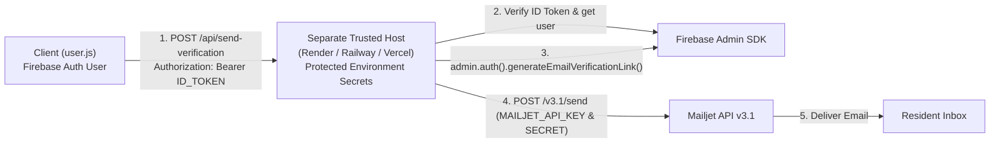

# Mailjet Email Verification Setup & Deployment Guide

This guide details the server-side email verification architecture for the OneVictoria Resident Hub. The verification delivery pipeline uses **Firebase Cloud Functions (2nd Gen)**, **Firebase Admin SDK**, **Firebase Secret Manager / Functions Emulator**, and the **Mailjet Send API (v3.1)** to replace direct client-side email dispatch with authenticated, rate-limited, and deliverability-optimized email delivery.

---

## 1. Local Testing with Firebase Functions Emulator

For local development and testing, you can test the entire flow locally on your machine without deploying Cloud Functions or incurring any cloud billing costs.

### Step 1: Create `functions/.secret.local`
Firebase Functions Emulator (2nd Gen) automatically loads server-side secrets from `functions/.secret.local`.

Create `functions/.secret.local` (or copy from `functions/.secret.local.example`):

```bash
# In functions/.secret.local
MAILJET_API_KEY=YOUR_ROTATED_MAILJET_API_KEY
MAILJET_SECRET_KEY=YOUR_ROTATED_MAILJET_SECRET_KEY
```

> [!CAUTION]
> - **Never commit secrets:** `functions/.secret.local` is strictly excluded in both `.gitignore` and `functions/.gitignore`.
> - **Never use frontend `.env` files for Mailjet keys:** Mailjet credentials must exist only in the server-side emulator or backend secret manager. They must never appear in `user.js`, HTML, or browser-accessible assets.
> - **Use newly rotated credentials:** Do not reuse previously exposed credentials; ensure your Mailjet API keys have been freshly generated and rotated.

### Step 2: Start the Firebase Emulator
From the project root:

```bash
firebase emulators:start --only functions
```

Or start both Functions and the Emulator UI:
```bash
firebase emulators:start
```

The emulator will output:
```text
✔  functions[default:sendVerificationEmail]: http function initialized (http://127.0.0.1:5001/onevictoria-23409/us-central1/sendVerificationEmail).
```

### Step 3: Local Client Connection
[`user.js`](file:///c:/Users/capin/Desktop/Resident/user.js) is already pre-configured to automatically connect to the local Functions emulator (`127.0.0.1:5001`) whenever the site is opened on `localhost` or `127.0.0.1`.

1. Serve the frontend locally (e.g., using VS Code Live Server or `python -m http.server 5000`).
2. Open `http://localhost:5000` in your browser.
3. Open the browser console to confirm:
   ```text
   [Firebase] Connected to local Functions Emulator at 127.0.0.1:5001
   ```
4. Register a test account or use "Resend Verification" on the sign-in modal.
5. Check your emulator terminal to see the verification link generation and Mailjet delivery status.

*(Tip: If you ever want to bypass the local emulator while on localhost, add `?emulator=0` to the browser URL or set `window.USE_FUNCTIONS_EMULATOR = false`.)*

---

## 2. Firebase Billing Plan Requirements vs. Spark Plan

> [!IMPORTANT]
> **Firebase Cloud Functions Deployment Requirements:**
> Deploying Firebase Cloud Functions (2nd Gen) requires the **Blaze (Pay-as-you-go)** billing plan. Google Cloud Functions (2nd Gen) is built on Google Cloud Run and Google Cloud Build, which mandate an active Google Cloud Billing account on the project.
>
> **No Bypass Notice:** Local `.env` files, `.secret.local`, or configuration parameters **cannot** bypass Firebase's cloud deployment requirements. If you attempt `firebase deploy --only functions` on the free **Spark** plan, the Firebase CLI will reject the deployment with:
> ```text
> Error: Your project onevictoria-23409 must be on the Blaze (pay-as-you-go) plan to complete this command.
> ```

---

## 3. Production Deployment Options

Depending on your Firebase project plan, choose **Option A** or **Option B**:

### Option A: Blaze Plan Deployment (Official Cloud Functions + Secret Manager)

If your Firebase project is upgraded to the Blaze plan:

1. **Configure Secrets in Firebase Secret Manager**:
   ```bash
   firebase functions:secrets:set MAILJET_API_KEY
   firebase functions:secrets:set MAILJET_SECRET_KEY
   ```
   *Enter the rotated secret values when prompted by the CLI. Values remain hidden and encrypted.*

2. **Deploy the Cloud Function**:
   ```bash
   firebase deploy --only functions
   ```

3. **Verify Deployment**:
   ```bash
   firebase functions:list
   ```

---

### Option B: Spark Plan Alternative (Separate Trusted Backend Host)

If production deployment must remain strictly on the free **Spark plan** without upgrading to Blaze, you cannot deploy Firebase Cloud Functions.

Instead, host a lightweight, trusted backend service on a separate platform with a free/low-cost tier (e.g., **Render**, **Railway**, **Fly.io**, or a **Vercel Serverless Function**):



#### How to implement the separate backend host:
1. **Host Environment Variables**: Store `MAILJET_API_KEY`, `MAILJET_SECRET_KEY`, and Firebase Admin service account credentials in the host's dashboard (e.g. Render/Railway Environment Settings). Never expose them to the browser.
2. **Express / Node.js Server Reference Implementation**:
   ```javascript
   const express = require("express");
   const cors = require("cors");
   const admin = require("firebase-admin");

   // Initialize Firebase Admin with Service Account JSON from environment
   const serviceAccount = JSON.parse(process.env.FIREBASE_SERVICE_ACCOUNT_JSON);
   admin.initializeApp({
     credential: admin.credential.cert(serviceAccount)
   });

   const app = express();
   app.use(cors({ origin: "https://onevictoria-23409.web.app" }));
   app.use(express.json());

   app.post("/api/send-verification", async (req, res) => {
     try {
       // 1. Verify caller identity using Firebase ID token
       const authHeader = req.headers.authorization || "";
       const token = authHeader.replace(/^Bearer\s+/, "");
       if (!token) return res.status(401).json({ error: "Unauthorized" });

       const decodedToken = await admin.auth().verifyIdToken(token);
       const uid = decodedToken.uid;
       const userRecord = await admin.auth().getUser(uid);

       if (userRecord.emailVerified) {
         return res.json({ success: true, alreadyVerified: true });
       }

       // 2. Generate official Firebase email verification link
       const actionCodeSettings = {
         url: "https://onevictoria-23409.web.app",
         handleCodeInApp: false,
       };
       const verificationLink = await admin.auth().generateEmailVerificationLink(userRecord.email, actionCodeSettings);

       // 3. Send via Mailjet Send API v3.1 using backend secrets
       const basicAuth = Buffer.from(
         `${process.env.MAILJET_API_KEY}:${process.env.MAILJET_SECRET_KEY}`
       ).toString("base64");

       const mjRes = await fetch("https://api.mailjet.com/v3.1/send", {
         method: "POST",
         headers: {
           "Content-Type": "application/json",
           Authorization: `Basic ${basicAuth}`,
         },
         body: JSON.stringify({
           Messages: [
             {
               From: { Email: "noreply@onevictoria.org", Name: "OneVictoria" },
               To: [{ Email: userRecord.email, Name: userRecord.displayName || "Resident" }],
               Subject: "Verify your email address - OneVictoria",
               HTMLPart: `<p>Please verify your email: <a href="${verificationLink}">Verify Email</a></p>`,
               TextPart: `Please verify your email: ${verificationLink}`,
               Headers: { "X-Mailjet-TrackClick": "0" },
             },
           ],
         }),
       });

       if (!mjRes.ok) throw new Error("Mailjet API dispatch error");

       return res.json({ success: true });
     } catch (err) {
       console.error("Verification dispatch error:", err.message);
       return res.status(500).json({ error: err.message });
     }
   });

   app.listen(process.env.PORT || 3000);
   ```

---

## 4. Mailjet Domain Authentication (SPF, DKIM, DMARC)

To prevent verification emails from landing in spam and eliminate email spoofing, configure your sending domain in DNS.

### Step 1: Add and Validate Domain in Mailjet
1. Navigate to **Mailjet Dashboard > Account Settings > Senders & Domains > Add a Domain**.
2. Enter your domain (e.g., `onevictoria.org`).
3. Add the ownership validation TXT record provided by Mailjet to your DNS provider.

---

### Step 2: Configure SPF (Sender Policy Framework)
Add or update a **TXT record** on your root domain:

- **Type:** `TXT`
- **Host / Name:** `@` (or `yourdomain.com`)
- **Value:**
  ```text
  v=spf1 include:spf.mailjet.com ~all
  ```

> [!NOTE]
> If you already have an existing SPF record (e.g. for Google Workspace or Microsoft 365), do **not** create a second SPF record. Merge them into a single record:
> `v=spf1 include:_spf.google.com include:spf.mailjet.com ~all`

---

### Step 3: Configure DKIM (DomainKeys Identified Mail)
Mailjet generates custom DKIM DNS values in **Account Settings > Senders & Domains > Manage Domains > Authenticate (DKIM)**:

- **Type:** `TXT`
- **Host / Name:** `mailjet._domainkey` (or `mailjet._domainkey.yourdomain.com`)
- **Value:**
  ```text
  k=rsa; p=MIGfMA0GCSqGSIb3DQEBAQUAA4GNADCBiQ... (paste exact key provided by Mailjet)
  ```

Click **Verify** in Mailjet after publishing the DNS record.

---

### Step 4: Configure DMARC (Domain-based Message Authentication)
Add a **TXT record** for DMARC:

- **Type:** `TXT`
- **Host / Name:** `_dmarc` (or `_dmarc.yourdomain.com`)
- **Initial Recommended Value (Monitoring mode):**
  ```text
  v=DMARC1; p=none; pct=100; rua=mailto:dmarc-reports@yourdomain.com; aspf=r; adkim=r
  ```
- **Strict Enforcement (After monitoring confirms clean delivery):**
  ```text
  v=DMARC1; p=quarantine; pct=100; rua=mailto:dmarc-reports@yourdomain.com; aspf=r; adkim=r
  ```

---

### Step 5: Deliverability Notice
> [!IMPORTANT]
> **Deliverability & Inbox Placement Notice:**
> Configuring SPF, DKIM, and DMARC authenticates your sender domain and eliminates unauthorized spoofing, which significantly improves email reputation with mailbox providers like Gmail, Yahoo, and Microsoft Outlook.
> 
> However, **100% inbox placement cannot be guaranteed** by DNS records or delivery providers alone. Receiving mail servers evaluate many factors dynamically, including:
> - Domain age and sending volume history (reputation warming)
> - User engagement (opening, marking as spam, or moving out of spam)
> - Recipient spam filter sensitivity and organizational firewalls
>
> If an email lands in spam during early testing, mark it as "Not Spam" to train the mailbox provider's algorithm for your sending domain.

---

## 5. Local Testing Verification Checklist

| Test Scenario | Steps to Execute | Expected Result |
| :--- | :--- | :--- |
| **Emulator Startup** | Run `firebase emulators:start --only functions` in terminal. | Functions emulator initializes at `127.0.0.1:5001`, loading secrets from `functions/.secret.local`. |
| **Client Auto-Connect** | Open website at `http://localhost:5000`. | Console displays `[Firebase] Connected to local Functions Emulator at 127.0.0.1:5001`. |
| **New Account Registration** | Submit sign-up form with a new email address. | Account is created in Firebase Auth; `sendVerificationEmail` is dispatched to the emulator; Mailjet delivers the verification email. |
| **Resend Verification Modal** | Click "Resend Verification?" on sign-in screen; enter credentials. | Client re-authenticates, calls local emulator function, and dispatches fresh verification link via Mailjet. |
| **Rate Limit Cooldown** | Request another verification email within 60 seconds. | Call is blocked with message: *"Please wait X seconds before requesting another verification email."* |
| **Link Verification** | Click the link in the received Mailjet email. | Browser opens Firebase Auth confirmation handler; `emailVerified` is set to `true`. |
| **Missing Secrets Warning** | Leave placeholders in `functions/.secret.local`. | Emulator logs inform the developer to configure `MAILJET_API_KEY` and `MAILJET_SECRET_KEY` in `functions/.secret.local`. |
